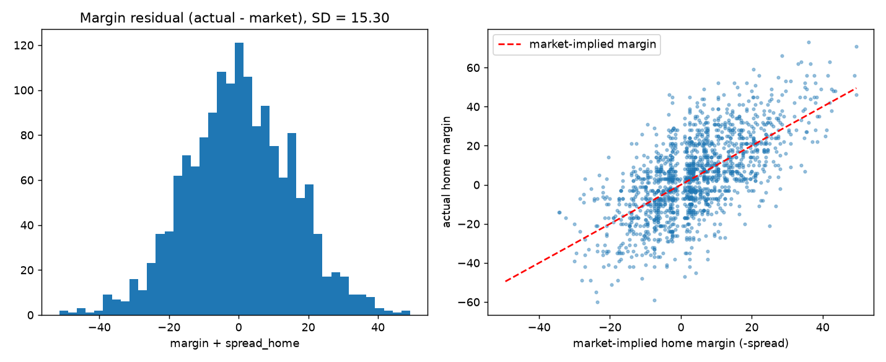
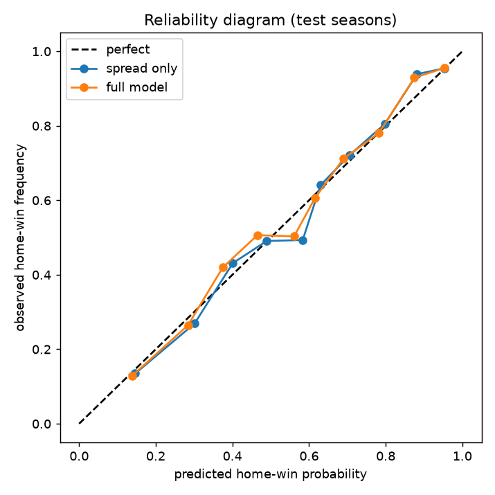
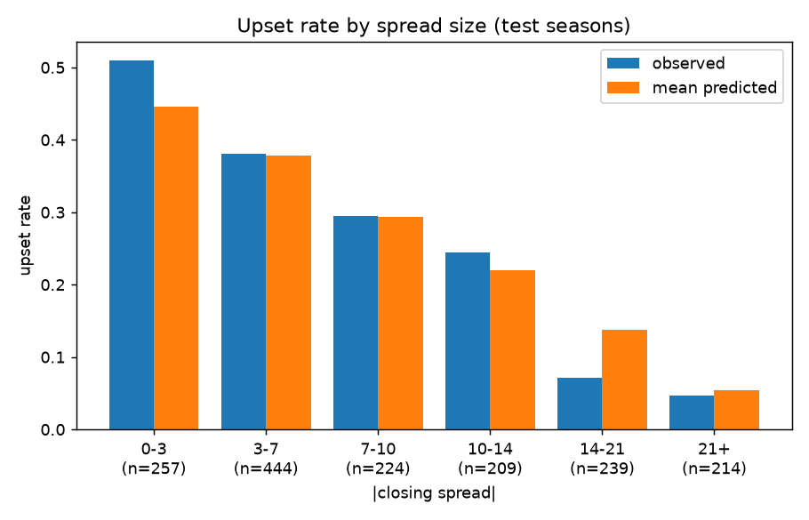
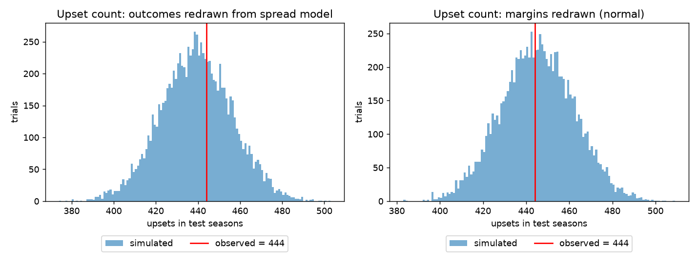
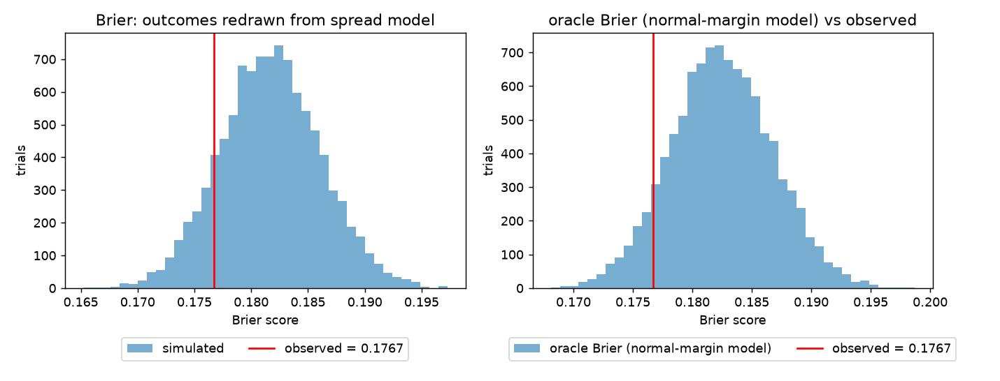

# Predicting College Football Upsets: A Statistical Research Study

**Tristan Morton** · November 2026

## Abstract

Can college football upsets be predicted, or are they governed by irreducible randomness? This study analyzes **3,900 NCAA FBS-vs-FBS games** from the 2019 and 2021–2024 seasons. Each game is paired with its consensus closing point spread, gathered through an ETL pipeline built on the CollegeFootballData.com REST API. Four hypotheses are tested with logistic and multivariate linear regression and evaluated out of sample on the 2023–24 seasons.

The closing spread is a strong, unbiased and well-calibrated forecast. It scores a Brier of **0.177**, against **0.244** for a naive baseline, which is 27% better. Adding team-strength ratings, venue, conference, week and the over/under does not improve on it out of sample: the Brier difference is +0.001, with a 95% CI of [−0.001, +0.003]. A **10,000-trial Monte Carlo** shows that the 444 upsets observed in 2023–24, the 15.3-point residual standard deviation, and the market's Brier score all fall inside what pure chance around the market line would produce.

Once the market has spoken, what remains is consistent with irreducible randomness.

Two threats to validity were neutralized and their impact measured with controlled reruns:
- **A look-ahead leak.** End-of-season team ratings used as pregame features would have reversed the central conclusion. They make the model appear to beat the market by 0.025 Brier, with a CI well below zero.
- **An API filtering bug.** It silently added 13.1% non-FBS records, which would have inflated measured skill by 4.7 points and produced a false finding of miscalibration.

# 1. Background

About one FBS game in four ends in an upset, with the betting underdog winning outright. Upsets drive the sport's drama, its playoff chaos and a large share of the betting market. A natural question follows: is there a pattern that a careful analyst could exploit?

Two views compete:
- **Upsets are predictable.** Measurable factors the market underweights, such as team strength, venue, conference play or the time of season, systematically mark games where the underdog is underrated.
- **Upsets are randomness.** The closing line already contains the public information. Upsets are the dice, and once the spread is known, the leftover outcome variation is noise.

The closing point spread is the natural benchmark. It is set by bookmakers and moved by bettors until money balances, and it is the market's consensus forecast of the final margin. If the spread is efficient, no public-feature model should beat it, and outcomes around it should behave like draws from a fixed distribution. This study tests both implications directly.

# 2. Data and pipeline

## 2.1 Source and scope

All data comes from the CollegeFootballData.com REST API:
- `/games`: scores, venue, conference and season type.
- `/lines`: point spreads and over/unders by sportsbook.
- `/teams/fbs`: the official FBS membership for each season.
- `/ratings/sp`: SP+ team ratings.

A small client (`cfb/api.py`) authenticates with a bearer token, retries with exponential backoff on rate limits and network errors, and caches every raw response to disk. As a result, the full study reruns offline and gives byte-identical results.

| Season | Games | Upset rate | Home win rate | Mean \|spread\| |
|---|---|---|---|---|
| 2019 | 771 | 25.2% | 59.3% | 12.0 |
| 2021 | 769 | 27.0% | 57.5% | 11.2 |
| 2022 | 773 | 27.4% | 57.6% | 11.2 |
| 2023 | 789 | 26.7% | 57.9% | 10.6 |
| 2024 | 798 | 29.2% | 58.4% | 10.4 |
| **All** | **3,900** | **27.1%** | **58.1%** | **11.1** |

The 2020 season is excluded. COVID cut it to 534 usable games, and many were played without crowds, which distorts home-field advantage. The population is FBS against FBS, regular season plus bowls (208 postseason games), restricted to completed games with a closing line.

## 2.2 Transformations

- **Consensus spread.** Each game's spread is the median closing line across sportsbooks (four per game at the median), taken from the home team's side. A negative spread means the home team is favored. The median resists a single stale or erroneous line.
- **Upset.** The closing underdog wins outright. Ten pick'em games, with a spread of exactly 0, have no underdog and are excluded.
- **Team strength.** SP+ ratings published for a season are computed after it ends, from the very games being predicted. Using them would leak the outcome into the feature. The pipeline uses each team's prior-season SP+ instead. Forty-three games involving teams new to FBS have no prior rating; this is reported, not imputed.

## 2.3 Data integrity and the filter bug

Every build runs an automated audit (`results/audit.json`). It counts duplicate games, duplicate sportsbook lines, orphaned lines, unparseable or impossible spreads, incomplete games, non-FBS teams, and a sign check: favorites should win roughly 60–90% of the time. A flipped spread convention would show up as about 27%, and the build refuses to continue if the check fails.

The first audit flagged **590 of 4,501 records (13.1%)** returned by `/games?classification=fbs` as involving a non-FBS team. Comparing the raw `homeClassification` and `awayClassification` fields showed the cause:
- 589 records were FBS teams hosting FCS opponents, and 1 was the reverse.
- The API's server-side filter keeps any game with *at least one* FBS team, not games where *both* are FBS.
- 561 of these games have betting lines, so a pipeline that trusted the filter would have kept almost all of them.

The fix validates both teams against `/teams/fbs` for each season, and a regression test guards it. To measure what the bug would have done, the pipeline rebuilds the dataset with the check bypassed and reruns the same analysis.

| Metric | Trusting the API filter | After the fix |
|---|---|---|
| Games | 4,461 | 3,900 |
| Upset rate (all seasons) | 24.4% | 27.1% |
| Mean \|spread\| | 13.4 | 11.1 |
| Spread-only Brier (test seasons) | 0.159 | 0.177 |
| Brier skill vs naive | 32.1% | 27.4% |
| Hosmer–Lemeshow p (calibration) | **0.029** (reject) | 0.062 (do not reject) |

FBS-vs-FCS games are lopsided and easy to call. Including them makes the market look **4.7 points more skillful** than it really is between FBS opponents. It also understates the test-season upset rate, at 24.9% against the true 28.0%. And it pushes the calibration test below α = 0.05, so the study would have wrongly concluded that the market is miscalibrated.

A matched comparison shows where the damage is. On the 1,587 FBS-vs-FBS test games present in both datasets, a model trained on the contaminated data predicts just as well as one trained on clean data. The Brier difference is −0.00003, with a 95% CI of [−0.00017, +0.00013]. **The bug corrupts the evaluation, not the model.** It changes which games are scored, and so it changes the conclusions drawn from the scores. Bugs like this are dangerous because the fitted model still looks fine.

## 2.4 Look-ahead leakage and its measured impact

The most consequential risk in this study was a look-ahead leak, not a corrupted record. The API's SP+ ratings for a season are computed after the season ends, from that season's own games. A model given those ratings as "pregame" features is partly told the results it is supposed to predict. The pipeline was designed from the start to use each team's prior-season rating, so no reported result is affected. To quantify what the leak would have done, the full analysis was rerun with same-season ratings. The split and seed were identical, and both arms were scored on the same 3,857 games, so only the rating's season changed.

| Metric (test seasons unless noted) | Leaky: same-season SP+ | Clean: prior-season SP+ |
|---|---|---|
| H2 likelihood-ratio statistic (train, df 5) | 313.8 (p ≈ 10⁻⁶⁵) | 11.2 (p = 0.048) |
| Full-model Brier | 0.151 | 0.178 |
| Full-model AUC | 0.858 | 0.803 |
| Brier skill vs naive, full model | 37.8% | 27.0% |
| Brier(full) − Brier(spread), 95% CI | **−0.025** [−0.032, −0.019] | +0.001 [−0.001, +0.003] |
| Does the full model beat the market? | **Yes** | **No** |

With the leak, the study would have confidently concluded the opposite of the truth: that public features predict games 14% better than the betting market, with a confidence interval nowhere near zero. Every one of those gains is information from the future. With honest pregame ratings, the edge disappears. A unit test pins the prior-season default.

# 3. Methods

## 3.1 Train/test design

Models are fit on 2019, 2021 and 2022 (2,313 games) and evaluated on 2023–2024 (1,587 games). Splitting by season means no future game informs a prediction, and the code refuses any split that would train on the future.

## 3.2 Hypotheses (α = 0.05)

| | Null hypothesis | Test |
|---|---|---|
| **H1** | The spread does not predict the winner. | Logistic regression of home win on spread; Wald test |
| **H2** | Other public information adds nothing once the spread is known. | Likelihood-ratio test: the spread-only logit nested in a model adding prior SP+ difference, neutral site, conference game, week and over/under (df = 5) |
| **H3** | Spread-implied probabilities are calibrated. | Calibration intercept and slope; Hosmer–Lemeshow, 10 bins (test seasons) |
| **H4** | The spread is an unbiased forecast of the margin. | OLS of margin on spread; ideal intercept 0, slope −1; R² compared with a multivariate OLS |

## 3.3 Evaluation

Probability forecasts are scored with the **Brier score**, the mean squared error between the predicted probability and the 0/1 outcome, where lower is better. Log loss and AUC are reported alongside it. There are three competitors:
- **Naive:** every game gets the training home-win rate.
- **Spread-only logit.**
- **Full logit**, with all features.

The full-vs-spread difference is tested with a paired cluster bootstrap. It draws 2,000 resamples over the 31 season-weeks in the test set, because games in the same week share conditions and are not independent.

## 3.4 Monte Carlo validation

The randomness hypothesis is tested directly by simulating 10,000 alternate versions of the 2023–24 test seasons. There are two null models, both fit on training data only:
1. **Outcome redraw.** Each game's winner is drawn as a coin flip weighted by the spread-only model's probability.
2. **Margin redraw.** Each game's margin is drawn as the market's expected margin plus Normal(0, σ), where σ = 15.43 points is the training SD of margin around the line.

Each trial records the number of upsets, the Brier score and the residual SD. The observed values are then placed in those distributions. The margin model also gives an **oracle Brier**: the score a forecaster with the exact true probabilities would get if outcomes really were the line plus noise. It shows how low a Brier score chance alone allows.

# 4. Results

## 4.1 H1: the spread predicts winners

Each point of spread shifts the log-odds of a home win by −0.109, with z = −21.3 and p ≈ 10⁻¹⁰⁰. **H1's null is rejected decisively.** A 7-point home favorite wins about 69% of the time in the model; a 14-point favorite wins about 83%.

## 4.2 H4: the spread is an unbiased forecast of the margin

| Model (train) | Intercept | Spread slope | R² | Residual SD |
|---|---|---|---|---|
| Spread only | −0.16 (p = 0.63) | **−1.000** (SE 0.023) | 0.456 | 15.43 |
| Spread + 5 features | — | −1.023 (SE 0.037) | 0.459 | 15.40 |

The fitted slope is −0.9997. Every point of spread moves the expected margin by exactly one point, and the intercept is indistinguishable from zero, so the market line is an unbiased forecast of the margin.

The spread explains 46% of the variance in final margins. The raw margin SD is 20.6 points; the SD left around the line is 15.4. Five extra features raise R² by only 0.003.



Figure 1. Left: residuals (actual margin minus market-implied margin) are roughly normal with SD 15.3 in the test seasons. Right: actual margins scatter symmetrically around the market line.

## 4.3 H2: little extra signal in-sample, none out of sample

In-sample, the likelihood-ratio test gives LR = 11.16 on 5 df, p = 0.048, which is just under α. The over/under carries the only individually significant coefficient (p = 0.010); prior SP+ is borderline (p = 0.058). Venue, conference and week are nowhere near significance.

The out-of-sample test is decisive:

| Forecast (2023–24, n = 1,554) | Brier | Log loss | AUC | Brier skill vs naive |
|---|---|---|---|---|
| Naive baseline | 0.2435 | 0.680 | 0.500 | — |
| **Spread only** | **0.1768** | **0.523** | **0.806** | **27.4%** |
| Full model | 0.1778 | 0.525 | 0.803 | 27.0% |

Brier(full) − Brier(spread) = +0.0010, with a cluster-bootstrap 95% CI of [−0.0010, +0.0028].

The full model is *slightly worse* out of sample, and the interval includes zero. The marginal in-sample signal does not survive contact with new seasons, which is the usual signature of overfitting noise. **The market spread alone captures nearly all of the predictive signal** available in these public features.

## 4.4 H3: the market is well calibrated

On the test seasons:
- The calibration intercept is −0.03 (SE 0.06), and the ideal is 0.
- The calibration slope is 1.09 (SE 0.06), and the ideal is 1.
- Hosmer–Lemeshow gives χ² = 14.9 on 8 df, p = 0.062.

**H3's null is not rejected:** when the spread says 70%, the favorite wins about 70% of the time.



Figure 2. Reliability diagram for the test seasons. Both models track the diagonal across the probability range.



Figure 3. Observed against predicted upset rate by size of spread. Close games (spread under 3) are near coin flips, with 51% upsets, and upsets fall steadily as the spread grows. The one notable gap is the 14–21 bucket: 7% observed against 14% predicted (n = 239), about 3 standard errors. In these two seasons, double-digit underdogs pulled off fewer upsets than the line implied. Taken across all ten probability bins, the Hosmer–Lemeshow test does not reject calibration (p = 0.062), so this reads as one bucket to watch, not a systematic bias.

# 5. Monte Carlo validation

| Statistic (2023–24) | Observed | Simulated mean | Simulated 95% range | Percentile | Two-sided p |
|---|---|---|---|---|---|
| Upsets (outcome redraw) | 444 | 438.7 | 405 – 472 | 63.9 | 0.77 |
| Upsets (margin redraw) | 444 | 444.7 | 411 – 478 | 49.5 | 0.99 |
| Residual SD (points) | 15.30 | 15.43 | 14.89 – 15.97 | 31.6 | 0.63 |
| Brier, spread model | 0.1767 | 0.1817 | 0.1732 – 0.1905 | 12.9 | 0.26 |
| Oracle Brier (margin model) | — | 0.1825 | 0.1741 – 0.1910 | — | — |



Figure 4. The 444 upsets observed in 2023–24 sit in the middle of 10,000 simulated seasons under both null models.



Figure 5. Left: the market's actual Brier is well within the simulated range. Right: it falls inside the range of the oracle forecaster's, whose probabilities are exactly right by construction under the margin model.

Every observed statistic falls comfortably inside its simulated distribution, with all p-values at least 0.26.
- **The upset count is ordinary.** It is exactly what a world of "market line plus random noise" produces.
- **The residual SD matches its simulated value.** The 15.3-point SD left after the spread is what that randomness alone generates, with no extra structure left to explain.
- **The market scores within the range of the oracle's.** In a line-plus-noise world, even a forecaster that knew the true probabilities would expect a Brier of about 0.182 (95% range 0.174–0.191). The market's 0.177 sits inside that range, which leaves little room for any forecaster to improve. (The oracle comes from the margin model and the market's score from the spread-only logit, so this is a comparison of ranges, not an exact floor.)

**The residual variance is consistent with irreducible randomness.**

# 6. Discussion

The four hypotheses agree. The closing spread strongly predicts winners (H1), forecasts margins without bias (H4) and is calibrated (H3). Public features that seem to matter, such as team strength, home field, conference play, timing and scoring environment, add nothing out of sample (H2). The 10,000-trial simulation then closes the remaining gap: the scatter of outcomes around the line is the size and shape that chance alone produces.

**The evidence is consistent with upsets being the expected tail of a well-priced distribution, not anomalies a better model could foresee.** With about 15 points of spread around the line, a 7-point underdog still wins roughly 30% of the time; the spread-only model puts it at 31%. Across the two test seasons, the 444 upsets sit in the middle of the simulated range.

A methodological lesson matters as much as the result. The biggest threats to a valid conclusion came from the data, not from the choice of model:
- **The look-ahead leak.** A rating that looks like a pregame feature but is computed from the season's results would have turned "the market cannot be beaten" into "our model beats the market by 14%". Avoiding it took a question asked before any code ran: *when was each feature knowable?*
- **The filter bug.** A filter that returned 13% wrong records looked reasonable at every step and would have produced a false finding of market miscalibration. Automated integrity checks against an independent source of truth, the official FBS membership list, caught it.

Both effects were measured with controlled reruns, so their impact is a number rather than a guess.

# 7. Limitations

- **Closing-line definition.** The API's `spread` field is taken to be the closing line; it is reported separately from `spreadOpen`. Timestamps are not available to verify this.
- **Small test-week sample.** The test set spans only 31 season-weeks, so the cluster-bootstrap interval is wide. Effects smaller than about 0.002 Brier cannot be ruled out.
- **Public features only.** Injury reports, weather, line movement and betting splits were not available. A richer information set could carry some edge, but it would have to beat a market whose score already sits inside the range chance alone produces.
- **Scope.** Results describe FBS-vs-FBS games from 2019 and 2021–2024. FCS matchups and earlier eras were not tested.

# 8. Conclusion

Across 3,900 FBS games, college football outcomes are predictable, and the betting market already predicts them about as well as the evidence allows. The closing spread cuts the naive forecast error by 27%. None of the five extra public features improves on it out of sample, and a 10,000-trial Monte Carlo shows that what remains (who wins the close games, which underdog pulls it off) is consistent with irreducible randomness.

# Appendix A. Reproducing the study

```
py -3.12 -m venv .venv
.venv/Scripts/pip install -r requirements.txt
# put CFBD_API_KEY=<key> in .env
.venv/Scripts/python run_study.py --seasons 2019,2021-2024 --seed 42 --trials 10000
.venv/Scripts/python -m pytest -q
.venv/Scripts/python report/build_pdf.py
```

Outputs:
- `results/results.json`: every number in this report.
- `results/audit.json`: the data-integrity counts.
- `results/figures/`: the figures.

`results.json["config"]` records the seasons, seed, library versions and the SHA-256 of the clean dataset. Two runs produce byte-identical output.

# Appendix B. Full model coefficients (training seasons)

| Feature | Logit coef | p | OLS coef (margin) | p |
|---|---|---|---|---|
| spread_home | −0.117 | <0.001 | −1.023 | <0.001 |
| sp_diff (prior SP+) | −0.0095 | 0.058 | −0.032 | 0.33 |
| total (over/under) | 0.016 | 0.010 | 0.088 | 0.027 |
| neutral | −0.122 | 0.52 | 0.061 | 0.96 |
| conference_game | 0.026 | 0.86 | 0.113 | 0.90 |
| week | 0.0003 | 0.99 | −0.108 | 0.28 |

The sign on sp_diff is negative once the spread is in the model, so it is not a clean independent effect. The spread already prices team strength, and the residual coefficient reflects collinearity, not extra information.
